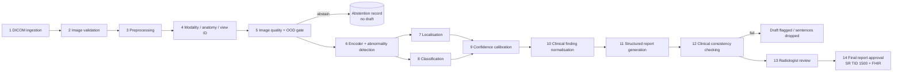
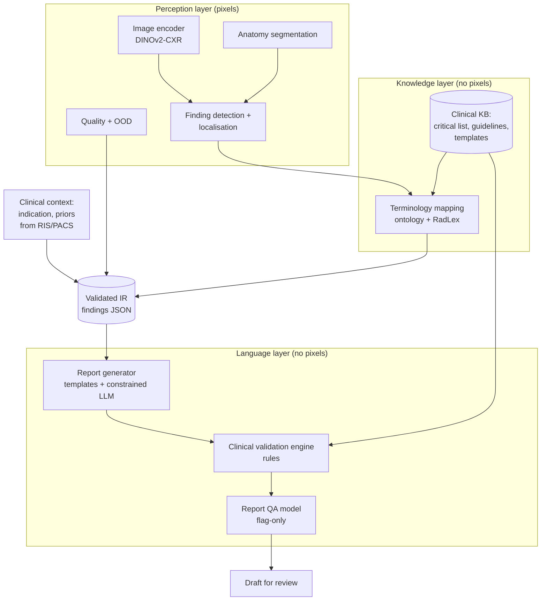

# 06 — Recommended AI Architecture

Status: draft v0.1 — 2026-11-25 · Part of the Radio R&D blueprint (see 00-index.md)

## 1. Design decision in one paragraph

Radio uses a **hierarchical, evidence-first pipeline**, not a single end-to-end vision-language model (VLM). Specialised, separately validated components turn pixels into a **validated intermediate representation (IR)** of findings (`src/radio/schema`). Every finding in the IR carries a status (`present | absent | uncertain | not_assessed`), a provenance, a calibrated probability and localisation evidence. Natural-language text is produced **only from the IR** plus explicitly supplied clinical context, by deterministic templates with an optional constrained LLM rephrasing step. A rule-based consistency checker then gates the draft, and a radiologist must approve it. The LLM never sees pixels in the product path.

**Why hierarchical (justification).**

1. **Verifiability.** Each stage has its own metric, test set and failure mode, which is what IEC 62304 unit/integration verification and FDA standalone performance testing expect. An end-to-end VLM has one opaque failure surface.
2. **Hallucination control.** CXR report generators that write free text directly from the image hallucinate findings and priors. Grounded systems such as MAIRA-2 and metrics such as RadFact exist because of this (see 02-literature-review.md). If the text layer can only verbalise IR entries, no finding can appear without upstream evidence.
3. **Licensing.** Every strong open CXR VLM is research-only or non-commercial (CheXagent, MAIRA-2, LLaVA-Rad, CheXOne, NV-Reason-CXR). Commercially clean components exist at the encoder (DINOv2, Apache-2.0), detector (torchvision BSD-3, RT-DETR/D-FINE Apache-2.0) and small-LLM (Apache-2.0 families) level. See 05-model-comparison.md.
4. **Regulatory fit.** US CADe predicates (21 CFR 892.2070) are detection and localisation devices. A modular design lets the detection module follow a 510(k) path while the report-drafting module, for which no cleared predicate was found, follows its own (likely De Novo) path. See 17-commercial-regulatory.md.
5. **Extensibility.** Stages 9–14 are modality-agnostic, so CT and MRI are added as new `Analyzer` plug-ins.

## 2. Pipeline overview



## 3. Stage-by-stage specification

Method key: **DL** = deep learning · **VLM** = vision-language model · **CL** = classical image processing · **RB** = rule-based validation · **KB** = clinical knowledge base · **HU** = human review.

| # | Stage | Input → Output | Method | Recommended component (license) | Key failure modes | Abstain / escalate when |
|---|---|---|---|---|---|---|
| 1 | DICOM ingestion | DICOM Part 10 over C-STORE / STOW-RS, or PNG/JPEG (research only) → `StudyRef` with instance files and parsed header | RB | pydicom, pynetdicom, dicomweb-client (MIT); archive dcm4chee-arc-light (MPL-1.1) or unmodified Orthanc sidecar | Truncated or corrupt files; vendor private tags; compressed transfer syntaxes without a decoder | Unreadable pixel data; unsupported transfer syntax → `ingest_error` |
| 2 | Image validation | Header + pixels → validated `ImageRecord` plus list of reasons | RB | `src/radio/ingest/dicom.py` | Wrong `Modality` (not CR/DX); `BodyPartExamined` missing or wrong; burned-in annotation flag; PHI in research path | Modality ∉ {CR, DX}; `BurnedInAnnotation=YES` in research path; pixel array missing → abstain with reason |
| 3 | Preprocessing | Raw pixels → normalised float tensor (H×W, intensity in [0,1]) | CL | Modality LUT → VOI LUT/window → MONOCHROME1 inversion → aspect-preserving resize + pad (`src/radio/preprocess`) | Wrong VOI LUT, giving low contrast; MONOCHROME1 not inverted; aggressive resize hides small findings | Bit depth or photometric interpretation not handled → abstain |
| 4 | Modality / anatomy / view ID | Tensor + header → `{modality, body_region, view: PA/AP/LAT/other, patient_age_group}` with probabilities | DL + RB | Header tags first (`ViewPosition`, `BodyPartExamined`); small CNN view/anatomy classifier trained on NIH CXR14 views + negative non-chest images; rules reconcile the two | Header says PA but image is AP portable; lateral views treated as frontal; paediatric images | View ∉ supported set (Phase 1: PA/AP frontal adult); header/model disagreement above threshold → `not_assessed` for all findings plus a reason |
| 5 | Image quality + OOD gate | Tensor + embeddings → `quality: {status, reasons[]}`, `ood_score` | CL + DL | Classical: dimensions, bit depth, histogram clipping, saturation and blank detection, rotation estimate. DL: Mahalanobis distance on encoder features fitted on training data (Lee et al. 2018; Fort et al. 2021), energy score (Liu et al. 2020) as a second signal (`src/radio/qc`) | Over- or under-exposure; severe rotation; heavy overlying hardware; non-CXR images that pass the header check; new scanner vendor | OOD score > τ_ood (chosen on a held-out OOD set for 95% TPR on in-distribution); quality `fail` → abstain. Quality `limited` → continue, but every finding's `uncertainty` gains `limited_quality`, and the report must say so |
| 6 | Encoder + abnormality detection | Tensor → image embedding + per-finding logits | DL | DINOv2 ViT-S/14 (proto) → ViT-B/14 or ViT-L/14 (product), Apache-2.0, continued self-supervised pretraining on commercially licensed CXRs; multi-label linear or MLP head (`src/radio/models`) | Shortcut learning (chest tubes ⇒ pneumothorax; hospital tokens); label noise from NLP-mined labels; class imbalance | — (handled by stages 5 and 9) |
| 7 | Localisation | Tensor + embedding → boxes, optional masks, heatmaps per finding | DL | Detector: torchvision Faster R-CNN (BSD-3) baseline → RT-DETR / D-FINE / RF-DETR Apache sizes. Segmentation (lungs, heart, pleural space, devices): nnU-Net 2D or MONAI (Apache-2.0). Heatmaps: exact class-activation maps from the linear head on mean-pooled patch tokens (`CXRClassifier.forward_with_maps`), stored as `Localization(method=activation_map, validated=false)` — **display-only, never used as measurement or laterality evidence** | Box on the wrong side; heatmaps highlighting text markers; small nodules missed | Phase 1: classifier-only findings are `model_inferred` (schema forbids `image_observed` without a validated localisation). Phase 2+, once a detector is validated: a present focal finding without detector localisation → capped at `uncertain` unless global (e.g. cardiomegaly via CTR from segmentation). If the classifier cannot assess a concept but a gated detector boxed it → `uncertain`, `image_observed`, never `present` (`pipeline/run.py`, v0.3) |
| 8 | Classification | Logits + detections → per-finding raw probability, subtype and laterality | DL + RB | Fuse the classifier probability with the maximum detection score per finding (logistic fusion fitted on validation data); laterality from box centroid relative to segmented midline, **never from image left/right alone**. Patient-left is image-right on PA view | Laterality flipped on AP or rotated images; device-related findings confused | Laterality conflict between box and segmentation → laterality `indeterminate` |
| 9 | Confidence calibration | Raw probability → calibrated probability + status | DL + statistics | Per-finding temperature scaling (Guo et al. 2017) on a site-matched calibration split; split-conformal / conformal-risk-control style thresholds (Angelopoulos & Bates 2021; Angelopoulos et al. 2022/2024), two per finding: `t_absent` controls the **false-negative rate** (fraction of true positives called `absent` ≤ α_FN) and `t_present` controls the **false-positive rate** (fraction of true negatives called `present` ≤ α_FP). p ≥ t_present → `present`; p < t_absent → `absent`; otherwise `uncertain` (deferred to the radiologist). Findings with too few calibration positives/negatives → `validated=false` → `not_assessed` (`src/radio/calibrate/conformal.py`) | Calibration drift at new sites; exchangeability violated | Upstream stage marked finding as not processed, or insufficient validation data → `not_assessed` (never `absent`) |
| 10 | Clinical finding normalisation | Per-finding outputs → IR `Finding` objects mapped to the internal ontology (`src/radio/ontology`) with RadLex IDs where verified | KB + RB | Internal CXR ontology: finding, anatomical location (lobe/zone/pleural space/mediastinum), laterality, severity scale where validated; RadLex mapping only from verified lookup tables | Duplicate concepts (opacity vs consolidation); unmapped labels from new datasets | Unmapped concept → dropped from IR, logged |
| 11 | Structured report generation | Validated IR + clinical context (indication, priors **only if provided**) → draft report sections, each `ReportSentence` carrying `finding_ids`, `kind` and `provenance` | RB (templates) + optional LLM | Deterministic templates per finding × status × provenance (`src/radio/report/generator.py`). Optional `Rephraser` (small Apache-2.0 LLM via constrained decoding — outlines/xgrammar, Apache-2.0) **only for rephrasing** single sentences while keeping their `finding_ids`. Disabled by default | LLM adds a finding, measurement or recommendation; uncertain becomes certain; negations dropped | Any rephrased sentence failing stage 12 → fall back to the template sentence |
| 12 | Clinical consistency checking | Draft + IR → pass/fail per sentence + report-level flags | RB + KB (+ optional QA model) | `src/radio/report/validator.py` rules: (a) every sentence maps to ≥1 IR finding or a provided-context item; (b) no finding mentioned with status ≠ its IR status; (c) laterality matches, per finding (each side word is bound to the finding term it modifies); (d) "No acute cardiopulmonary abnormality" only if no finding is `present`/`uncertain` **and** every core acute concept (`CORE_ACUTE_CONCEPTS`) was assessed and is `absent`; (e) recommendations only with `guideline_id` in `APPROVED_GUIDELINES` (empty in Phase 1); (f) comparison language only in `comparison` sentences, each citing a radiologist-verified prior, with the claimed change (new / persistent / resolved) recomputed from the IR and the prior (`report/comparison.py`); (g) numbers only if they match a measurement object of a cited finding; (h) critical findings appear in the impression (generator puts them first); (i) uncertainty language preserved ("possible", "cannot exclude") for `uncertain`; plus negation-polarity checks, every present/uncertain finding reported, every `not_assessed` finding disclosed, AI disclaimer intact | Rule gaps; template bugs | Rephrased sentence failing, or using any word outside the template's vocabulary plus a short neutral list → template sentence kept. Report-level failure → `validation_passed=false` with `validation_issues`; the UI shows a banner and the API refuses a plain `approve` (radiologist must `amend` with own text or `reject`) |
| 13 | Radiologist review | Draft + overlays → per-finding accept/reject/edit, free-text edits | HU | OHIF v3 fork (MIT), Radio review extension (see 10-system-architecture.md §6) | Automation bias; alert fatigue | Critical finding with `present` or `uncertain` → worklist priority + notification (09-safety-validation.md §4) |
| 14 | Final report approval | Reviewed report → signed report; DICOM SR (TID 1500), optional DICOM SEG, FHIR `DiagnosticReport` (`status=final`); audit record | HU + RB | highdicom (MIT), fhir.resources (BSD); `POST /v1/reports/{id}/review` with an authenticated reviewer; append-only audit log | Approval without review (rubber-stamping); identity spoofing | API rejects `approved` without an authenticated radiologist identity; reports are never auto-finalised |

### Which stages use what

| Method | Stages |
|---|---|
| Deep learning | 4 (view/anatomy CNN), 5 (OOD features), 6, 7, 8 |
| Vision-language model | **Not in the product path in Phase 1–3.** Used offline for (i) image–report alignment pretraining (stage 5 of 07-training-strategy.md), (ii) benchmarking against research VLMs, (iii) a future "missing finding" QA model that only *flags* drafts for review and never writes text |
| Classical image processing | 3, 5 (quality), parts of 8 (midline / CTR geometry) |
| Rule-based validation | 1, 2, 4 (tag reconciliation), 10, 11 (templates), 12 |
| Clinical knowledge base | 10 (ontology, RadLex), 12 (critical-finding list, guideline-backed recommendation library, e.g. Fleischner-type nodule recommendations only when nodule size is measured and the guideline applicability conditions are present in context) |
| Human review | 13, 14; plus annotation and adjudication offline |

## 4. Multimodal reasoning architecture

### 4.1 Components



### 4.2 Hierarchy and reliability

A three-level hierarchy (perception → knowledge → language) improves reliability for three reasons:

- **Error containment.** Language-layer errors cannot create findings, because the validator rejects any sentence without an IR anchor.
- **Independent verification.** Perception is validated with AUROC, FROC and Dice; language with finding-level precision/recall and hallucination rate (08-evaluation-protocol.md).
- **Separable change control.** Retraining the detector changes the IR distribution but not the text logic, which keeps PCCP modifications scoped (09-safety-validation.md §8).

The cost is lower fluency and no free-form "gestalt" descriptions. We accept that trade-off for a regulated draft-report product.

### 4.3 Evidence separation

Each IR element carries a `provenance` enum. Only some provenances can contribute specific text.

| Provenance | Meaning | Allowed in Findings section | Allowed in Impression | Example template behaviour |
|---|---|---|---|---|
| `image_observed` | Directly detected by perception with localisation evidence | Yes | Yes | "Right-sided pleural effusion." |
| `model_inferred` | Derived from other outputs by rule (e.g. CTR > 0.5 ⇒ cardiomegaly) or by a model without direct localisation | Yes, with inference wording | Yes, with hedging | "Enlarged cardiac silhouette (cardiothoracic ratio approximately 0.56, model-estimated)." |
| `clinical_history` | From the order or indication (RIS / HL7 ORM / FHIR ServiceRequest) | Clinical information section only | Only as context for prioritisation | "Indication: shortness of breath." |
| `prior_report` | Text from a linked prior report, retrieved, never generated | Comparison section only | "Compared with …" only if a prior is linked **and** the finding exists in both | "Pleural effusion, previously reported on 2026-10-02, …" |
| `radiologist_entered` | Added or edited by the reviewer | Yes | Yes | Verbatim |
| *(unsupported assumption)* | Anything without one of the above | **Never** | **Never** | Validator rule (a) rejects it |

Missing information is never converted into a negative. A finding the model did not evaluate is `not_assessed` and is either omitted or listed as "not assessed by AI". It is never "no X".

### 4.4 Why the LLM only consumes the validated IR

- **Faithfulness by construction.** Constrained decoding limits the output to a schema whose elements must reference existing `finding_id`s. A post-hoc validator then rechecks status, laterality and negation.
- **Auditability.** For every sentence the audit log stores `(template_id | llm_model_version, finding_ids, validator_result)`.
- **Swap-ability.** The LLM can be replaced (or removed) without revalidating perception.
- **Licensing.** Small Apache-2.0 LLMs suffice for rephrasing. Medical VLM weights with research-only or HAI-DEF terms are not needed in the shipped path.

## 5. Modularity for CT and MRI — the `Analyzer` interface

Implemented minimal contract (`src/radio/pipeline/analyzer.py`; `CXRAnalyzer` adapts the Phase-1 pipeline):

```python
class Analyzer(Protocol):
    modalities: frozenset[str]          # {"CR", "DX"}, {"CT"}, {"MR"}, ...
    body_region: str                    # "CHEST", "HEAD", ...
    version: str                        # recorded in AnalysisResult.model_versions
    def accepts(self, modality: str, body_part: str | None) -> bool: ...
    def analyze(self, path, *, context: ClinicalContext | None = None) -> AnalysisOutput: ...
```

Planned refinement for 3D modalities (Phase 7) splits `analyze` into the stage-level hooks below so quality, calibration and vocabulary can be validated per analyzer:

```python
    def preprocess(self, study) -> PreparedInput: ...        # stage 3 (2D tensor or 3D volume)
    def assess_quality(self, x) -> ImageQuality: ...         # stage 5
    def analyse(self, x) -> list[RawFinding]: ...            # stages 6–8
    def calibrate(self, raw) -> list[Finding]: ...           # stage 9
    def finding_vocabulary(self) -> list[str]: ...           # stage 10
```

- The pipeline router picks the first analyzer whose `accepts()` is positive. If none accepts, the study is marked unsupported and nothing is drafted.
- Stages 10–14 (ontology, IR, templates, validator, review, export) are shared.
- A CT analyzer adds 3D localisation (`bbox3d` or SEG references by `SeriesInstanceUID` + frame numbers). Today `Localization` has `method`, a 2D `bbox` and `heatmap_uri`; Phase 7 extends it (schema minor version bump) with `bbox3d` and `segment_ref` fields.
- Volumetric segmentation uses nnU-Net 3D full-resolution or MONAI. Training runs on cloud GPUs; MPS lacks 3D convolution support per the nnU-Net install docs (unverified for current PyTorch).

## 6. Prototype vs product configuration

| Aspect | Phase-1 prototype (this Mac) | Product target |
|---|---|---|
| Encoder | DINOv2 ViT-S/14, 448 px input, fine-tuned on an NIH CXR14 subset | ViT-B/14 or ViT-L/14, CXR SSL on ≥ several hundred thousand licensed images, 518 px or higher |
| Localisation | Class-activation display maps (shown to point at chance level, 13 §4.2, so display-only); Faster R-CNN on ChestX-Det with per-class leak-reduced gating (Phase 2) | RT-DETR / D-FINE family + nnU-Net 2D anatomy |
| Calibration | Temperature + split-conformal thresholds on the internal validation split | Per-site recalibration check during installation; PCCP-governed thresholds |
| Text | Templates only | Templates + optional constrained LLM rephrase |
| Output | JSON IR, draft text, SR, FHIR (preliminary) | Same, plus IHE AIR conformance |

## Sources

- Lee, Lee, Lee, Shin. *A Simple Unified Framework for Detecting Out-of-Distribution Samples and Adversarial Attacks.* NeurIPS 2018. https://arxiv.org/abs/1807.03888
- Liu, Wang, Owens, Li. *Energy-based Out-of-distribution Detection.* NeurIPS 2020. https://arxiv.org/abs/2010.03759
- Fort, Ren, Lakshminarayanan. *Exploring the Limits of Out-of-Distribution Detection.* NeurIPS 2021. https://arxiv.org/abs/2106.03004
- Guo, Pleiss, Sun, Weinberger. *On Calibration of Modern Neural Networks.* ICML 2017. https://arxiv.org/abs/1706.04599
- Angelopoulos et al. *Conformal Risk Control.* ICLR 2024. https://arxiv.org/abs/2208.02814
- MAIRA-2 (grounded report generation; research licence): https://huggingface.co/microsoft/maira-2 · arXiv 2406.04449
- RadFact metric (MIT): https://github.com/microsoft/RadFact
- DINOv2 (Apache-2.0): https://github.com/facebookresearch/dinov2
- torchvision detection models (BSD-3): https://github.com/pytorch/vision
- nnU-Net (Apache-2.0): https://github.com/MIC-DKFZ/nnUNet · MONAI (Apache-2.0): https://github.com/Project-MONAI/MONAI
- outlines (Apache-2.0): https://github.com/dottxt-ai/outlines · xgrammar (Apache-2.0): https://github.com/mlc-ai/xgrammar
- highdicom (MIT): https://github.com/ImagingDataCommons/highdicom · fhir.resources (BSD): https://github.com/nazrulworld/fhir.resources
- OHIF Viewers (MIT): https://github.com/OHIF/Viewers
- FDA CDS guidance (criterion 1 excludes image analysis): https://www.fda.gov/regulatory-information/search-fda-guidance-documents/clinical-decision-support-software
- Model and dataset licence findings: see 04-dataset-licensing-matrix.md and 05-model-comparison.md (research conducted 2026-11-25).
