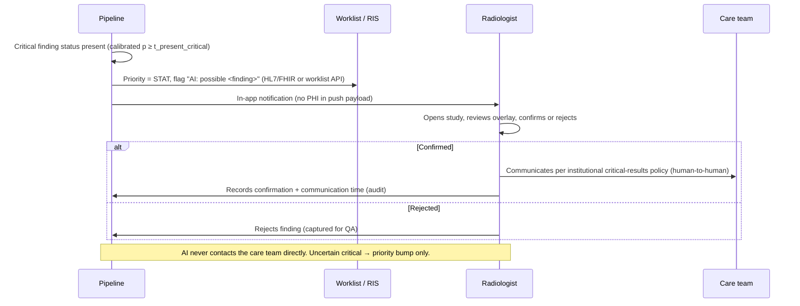

# 09 — Clinical Safety and Validation Plan

Status: draft v0.1 — 2026-11-25 · Part of the Radio R&D blueprint (see 00-index.md)

**Scope.** This document covers safety risk management for Radio as software as a medical device (SaMD) that:

- detects and localises chest X-ray findings;
- drafts reports that a qualified radiologist must review and approve.

It follows the structure of ISO 14971 (risk management), with IEC 62304 (software lifecycle), IEC 62366-1 (usability) and IMDRF GMLP N88 as companion frameworks. **Radio has no regulatory clearance or approval and is not clinically validated.** Nothing in this repository may be used for clinical decisions.

## 1. Intended use (draft, for hazard analysis)

> Radio is intended to assist qualified radiologists in the interpretation of adult frontal (PA/AP) chest radiographs by (a) identifying and localising specified radiographic findings and (b) generating a draft preliminary report for the radiologist to review, edit and approve. Radio does not provide a diagnosis, is not intended for autonomous reporting, and its outputs must not be used without radiologist review. Not intended for paediatric patients (< 18 y), lateral-only studies, or non-chest radiographs.

Users: radiologists, and radiology residents under supervision. Environment: hospital/teleradiology reading rooms integrated with PACS/RIS.

## 2. Hazard analysis (ISO 14971-style)

Scales:

- **Severity (S):** 1 negligible · 2 minor · 3 serious · 4 critical · 5 catastrophic.
- **Probability (P):** 1 improbable · 2 remote · 3 occasional · 4 probable · 5 frequent.
- **Risk:** S×P. ≥ 12 is unacceptable without further control; 6–11 is ALARP (as low as reasonably practicable); ≤ 5 is acceptable.

Initial values are engineering estimates, to be re-scored with clinical input and field data.

| ID | Hazard / hazardous situation | Cause(s) | Harm | S | P₀ | Risk controls (→ requirement) | P₁ | Residual |
|---|---|---|---|---|---|---|---|---|
| H1 | False-negative critical finding (e.g. pneumothorax) and radiologist anchors on "no acute findings" draft | Model miss; automation bias | Delayed treatment; death | 5 | 3 | "No acute" wording only if every assessed finding is `absent` and quality OK (validator rule d); `t_absent` set by conformal risk control with α_FN ≤ 0.05 for critical findings; draft labelled AI-generated; reviewer must open the image before approve (UI gate); MRMC automation-bias probes | 2 | 10 ALARP |
| H2 | False-positive critical finding | Artefact, tube or skin fold mimics | Unnecessary intervention, anxiety | 3 | 3 | Localisation required for `present`; overlays visible; calibrated probability shown; confirm-before-escalate for AI-originated critical alerts | 2 | 6 ALARP |
| H3 | Hallucinated finding in draft text | LLM rephraser; template bug | Wrong diagnosis or treatment | 4 | 3 | LLM consumes IR only; constrained JSON with `finding_ids`; validator rule a; fallback to templates; rephraser off by default | 1 | 4 OK |
| H4 | Wrong laterality | Flipped AP image; rotated patient; L/R marker error; template bug | Wrong-side procedure (e.g. chest drain) | 5 | 2 | Laterality from segmentation midline + box; `indeterminate` on conflict; validator rule c; no horizontal-flip augmentation; UI shows patient-orientation markers | 1 | 5 OK |
| H5 | Missing information read as negative | Unassessed finding omitted or phrased as "no X" | Missed diagnosis | 4 | 3 | `not_assessed` status in schema; templates never negate `not_assessed`; report lists "not assessed by AI" scope | 1 | 4 OK |
| H6 | OOD input processed (paediatric, lateral, non-chest, unusual device) | Header mislabel; new scanner | Unreliable output trusted | 4 | 3 | Header + CNN gate; Mahalanobis/energy OOD gate; abstention with reason; no draft on abstain | 2 | 8 ALARP |
| H7 | Poor-quality image yields confident output | Under- or over-exposure, rotation, motion | Missed or false finding | 3 | 3 | Classical quality gate → `fail` abstain / `limited` flag; report states limitation | 2 | 6 ALARP |
| H8 | Unreviewed draft becomes final | Integration bug; misconfigured auto-sign in RIS | Any of the above without human check | 5 | 2 | API cannot set `approved` without authenticated radiologist; FHIR `status=preliminary` and SR `PreliminaryFlag=PRELIMINARY` until signed; integration test; RIS contract requires human signature | 1 | 5 OK |
| H9 | Wrong patient or study association | Accession mismatch, worklist race | Wrong-patient report | 5 | 2 | Match on StudyInstanceUID + accession + patient key; reject on mismatch; show demographics header in UI | 1 | 5 OK |
| H10 | Unsupported recommendation | LLM or template adds follow-up advice | Over- or under-treatment | 3 | 2 | Recommendations only from KB with `guideline_id` + applicability conditions; validator rule e | 1 | 3 OK |
| H11 | Fabricated comparison with prior | Text claims change without a prior | Wrong trend judgement | 3 | 3 | Comparison only if a prior is linked and both IRs contain the finding (provenance `prior_report`); validator rule f | 1 | 3 OK |
| H12 | Performance degradation at a new site or after a scanner update | Dataset shift | Systematic misses | 4 | 3 | Site acceptance test before go-live; drift monitoring (§6); OOD rate alarms; PCCP-controlled recalibration | 2 | 8 ALARP |
| H13 | Subgroup underperformance | Training data imbalance | Inequitable harm | 4 | 3 | Subgroup analysis gates (08 §5); data acquisition targeting gaps; labelling limitations in IFU | 2 | 8 ALARP |
| H14 | Alert fatigue causing ignored true critical alerts | Too many low-PPV alerts | Delayed treatment | 4 | 3 | Critical alerts only for `present` at high-PPV threshold; `uncertain` critical → priority bump without page; monitor alert PPV | 2 | 8 ALARP |
| H15 | Cybersecurity compromise alters outputs or leaks PHI | Attack on API, model or supply chain | Wrong reports; privacy breach | 4 | 2 | 524B controls, SBOM, signed model artefacts with hash verified at load, mTLS, RBAC, audit (10-system-architecture.md §7) | 1 | 4 OK |
| H16 | Model or version confusion | Wrong model deployed | Unvalidated behaviour | 4 | 2 | Model registry with signed `clinical-approved` stage; IR records `model_versions`; startup self-test on a reference set | 1 | 4 OK |
| H17 | Latency causes AI output to arrive after report signed | Queue backlog | Missed benefit; confusing late changes | 2 | 3 | SLA monitoring; late results flagged "arrived after signature" and never auto-amend | 2 | 4 OK |

The full risk file (living document) is kept in the QMS. Each control maps to a software requirement ID and a verification test. For example, H8 is verified by `tests/api/test_review_flow.py::test_cannot_approve_without_reviewer`.

## 3. Safety controls by design

| Control | Mechanism | Where |
|---|---|---|
| AI-content labelling | Every draft, overlay, SR and FHIR resource carries "AI-generated draft — requires radiologist review"; SR `PreliminaryFlag`, FHIR `DiagnosticReport.status=preliminary`, plus an extension/tag naming the algorithm and version | `src/radio/report`, `src/radio/export` |
| Uncertainty preservation | Tri-state+ status; calibrated probability displayed; hedged templates for `uncertain`; validator forbids certainty upgrades | `src/radio/schema`, `src/radio/report/validator.py` |
| Abstention | Stages 2, 4 and 5 can abstain → no draft, reason shown to the user, study proceeds as normal unaided read | `src/radio/pipeline/run.py` |
| OOD detection | Mahalanobis + energy on encoder features; threshold from validation; rate monitored | `src/radio/qc/ood.py` |
| Quality gate | Classical exposure, size and rotation checks → `ok / limited / fail` | `src/radio/qc/quality.py` |
| Never auto-finalise | State machine `draft → in_review → approved/amended/rejected`; only an authenticated radiologist action moves to `approved/amended`; no API path or configuration flag to bypass | `src/radio/api` |
| Critical-finding escalation | See §4 | pipeline + UI + notification service |
| Automation-bias mitigation | (a) Image must be displayed ≥ N seconds and a findings panel interaction recorded before Approve is enabled (N set by usability study). (b) Optional "read first, reveal AI" mode. (c) Per-finding accept/reject rather than whole-report accept. (d) Periodic blinded QA cases. (e) Training material and IFU warnings | OHIF review extension |
| Audit trail | §5 | `src/radio/audit` |

## 4. Critical-finding escalation path

Phase-1 critical list (proposal, clinical sign-off needed): pneumothorax, endotracheal or enteric tube malposition (Phase 2+ when device detection exists), pneumoperitoneum (future), large pleural effusion (severity-validated only).

## 5. Audit trail

- **Append-only event log.** Prototype: hash-chained JSONL. Product: PostgreSQL `audit_events` with hash chaining plus write-once object-storage export.
- **Events logged:** study received; validation result; each pipeline stage (model version, config hash, duration); abstentions; IR created; draft created (template/LLM IDs); validator results; each UI view and interaction relevant to review; edits (diff); approval/rejection with reviewer identity and time; exports sent; notifications.
- **Retention:** per jurisdiction medical-records rules (configurable). Access to the audit log is itself audited.
- **The audit log records Radio's own actions and cannot be disabled by configuration** (requirement).

## 6. Post-market performance monitoring

| Signal | Metric | Alarm (proposal) |
|---|---|---|
| Input drift | Distribution of manufacturer, view, pixel spacing, age; embedding drift (MMD / population stability index on encoder features, Evidently) | PSI > 0.2 on any key covariate for 7 days |
| OOD rate | % abstained by reason | > 2× site baseline over 7 days |
| Output drift | Per-finding positive and uncertain rates | Outside 99% control limits (CUSUM) |
| Agreement | Per-finding reject rate by radiologists; clinically significant edit rate; acceptance rate | Trend +50% vs baseline over 4 weeks |
| Critical alerts | PPV of AI critical alerts (confirmed/total) | Below the validated lower CI bound |
| Discordance audit | Monthly sample of signed reports vs AI IR, adjudicated | Any systematic miss pattern |
| Latency/availability | p95 end-to-end latency; uptime | SLA breach |

Monitoring data uses de-identified aggregates where possible. Any use of radiologist corrections for **retraining** requires an approved data-governance and training policy and the relevant contractual and consent basis (GDPR Art. 6/9, HIPAA BAA scope, DPDP). By default, corrections are captured **for QA only**.

## 7. Incident handling and vigilance

1. **Detect:** monitoring alarm, user complaint, or a discordance audit.
2. **Triage** within 1 business day: complaint record in the QMS (ISO 13485 §8.2.2).
3. **Contain:** per-site kill switch disables AI drafting while studies continue unaided; a model rollback path exists.
4. **Investigate:** root cause analysis using the audit log, and replay of the exact model version on the case.
5. **Report** per market:
   - US: Medical Device Reporting (MDR) under 21 CFR 803.
   - EU: MDR vigilance (Art. 87) via EUDAMED/national competent authority.
   - India: CDSCO adverse-event reporting under MDR 2017 and the Materiovigilance Programme of India.
   - Timelines are as defined by each regulation; to be confirmed by regulatory affairs (unverified here).
6. **CAPA and field safety corrective action** if needed.

## 8. Change control and PCCP

- **Software changes** follow IEC 62304 change control. Every model is a configuration item with a version, dataset manifest, licence class and validation report.
- **US.** A **Predetermined Change Control Plan (PCCP)** (FDA final guidance issued Dec 2024; FDA page shows an Aug 2025 version) is submitted with the first marketing submission. It pre-specifies the allowed modifications, with a Modification Protocol and an Impact Assessment for each:
  - retraining on additional licensed data with the same architecture;
  - per-site threshold recalibration within bounds;
  - adding manufacturers to the supported list after a site acceptance test.
  - Changes outside the PCCP need a new submission. Precedent: Qure.ai qXR-Detect K251934 was cleared with a PCCP.
- **EU.** Significant changes require Notified Body assessment under MDR. The AI Act's high-risk obligations for Annex I devices apply from 2 Aug 2028 (Reg. (EU) 2026/1744). The Notified Body assesses AI Act conformity together with MDR.
- **India.** The CDSCO MDSW guidance (21 Jul 2026) expects an Algorithm Change Protocol where applicable.
- **Locked vs adaptive.** Shipped models are **locked**. No online learning in the field.

## 9. Validation plan summary

| Step | Evidence | Doc |
|---|---|---|
| Software verification | Unit, integration and system tests; validator property tests; reproducible builds | 13-prototype-plan.md |
| Standalone performance | Per-finding metrics on external multi-site data | 08 §1–5 |
| Clinical performance | MRMC reader study (aided vs unaided) | 08 §6 |
| Usability | IEC 62366-1 formative studies plus a summative study of the review/approve workflow, including automation-bias scenarios | 10 §6 |
| Silent-mode prospective | Live-site shadow evaluation | 08 §7 |
| Controlled pilot | Supervised deployment with ethics and regulatory approvals as applicable | 15-roadmap.md, Phase 6 |

## Sources

- ISO 14971:2019, IEC 62304, IEC 62366-1, ISO 13485:2016, IEC 82304-1, IEC 81001-5-1 (standards; content not reproduced)
- IMDRF GMLP N88 (final 27 Jan 2025): https://imdrf.org/sites/default/files/2025-02/IMDRF_AIML%20WG_GMLP_N88%20Final.pdf
- FDA PCCP guidance: https://www.fda.gov/regulatory-information/search-fda-guidance-documents/marketing-submission-recommendations-predetermined-change-control-plan-artificial-intelligence · FR notice 4 Dec 2024: https://www.govinfo.gov/content/pkg/FR-2024-12-04/html/2024-28361.htm
- Qure.ai qXR-Detect K251934 (with PCCP): https://www.accessdata.fda.gov/cdrh_docs/pdf25/K251934.pdf
- FDA cybersecurity premarket guidance (524B), FR 27 Jun 2025: https://www.govinfo.gov/content/pkg/FR-2025-06-27/html/2025-11669.htm
- EU AI Act amendment Reg. (EU) 2026/1744: https://eur-lex.europa.eu/eli/reg/2026/1744/oj?locale=en
- CDSCO MDSW guidance summary: https://natlawreview.com/article/code-compliance-decoding-indias-medical-device-software-guidance
- OOD/calibration papers: https://arxiv.org/abs/1807.03888 · https://arxiv.org/abs/2010.03759 · https://arxiv.org/abs/2208.02814
- Evidently (Apache-2.0): https://github.com/evidentlyai/evidently
- 21 CFR 803 (Medical Device Reporting): https://www.ecfr.gov/current/title-21/chapter-I/subchapter-H/part-803 · MDR Art. 87 vigilance in Regulation (EU) 2017/745: https://eur-lex.europa.eu/eli/reg/2017/745/oj (reporting timelines not re-checked this session)
