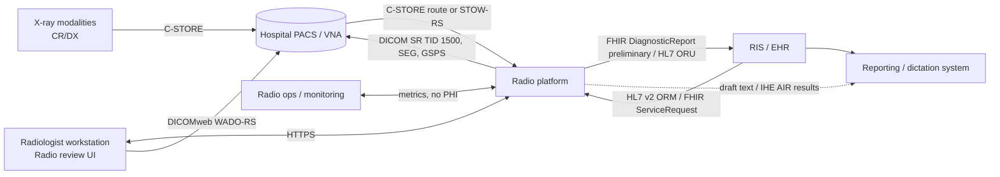
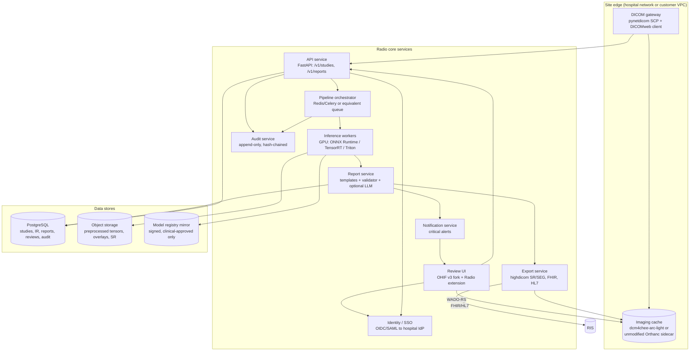
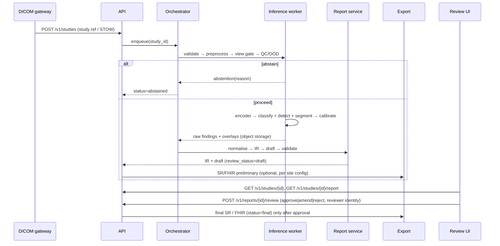
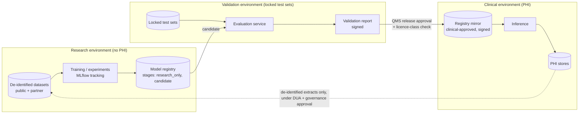
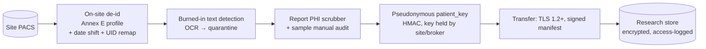

# 10 — System Architecture

Status: draft v0.1 — 2026-11-25 · Part of the Radio R&D blueprint (see 00-index.md)

Companion documents: 11-api-spec.md (API), 12-database-design.md (schema), 06-recommended-architecture.md (AI pipeline), 09-safety-validation.md (safety controls).

## 1. System context

## 2. Container / service view (clinical environment)

| Service | Responsibility | Tech (licence) | Scales on |
|---|---|---|---|
| DICOM gateway | Receive C-STORE, query/retrieve, STOW-RS; route to Radio; de-dup by SOPInstanceUID | pynetdicom, dicomweb-client (MIT); optional GoogleCloudPlatform dicomweb-adapter (Apache-2.0) | Studies/min |
| Imaging cache | Hold studies for viewer and inference | dcm4chee-arc-light (MPL-1.1), or Microsoft dicom-server (MIT), or Orthanc **unmodified as a separate process** (GPL-3.0 core / AGPL-3.0 plugins; no Radio code inside Orthanc) | Storage |
| API | REST API (11-api-spec.md), authN/Z, state machine for review | FastAPI (MIT), Pydantic (MIT) | CPU |
| Orchestrator | Stage DAG, retries, timeouts, abstention routing, idempotency | Celery (BSD) or RQ on Redis (BSD-3 up to 7.2.4; later versions RSALv2/SSPLv1/AGPLv3, so use Valkey (BSD-3) or a pinned version; licence change unverified for the current release) | Queue depth |
| Inference workers | Stages 3–9 | PyTorch (BSD-3) for dev; ONNX Runtime (MIT, unverified this session) / NVIDIA Triton (BSD-3) / TensorRT for production | GPU |
| Report service | Stages 10–12 | Python; outlines/xgrammar (Apache-2.0) when the LLM is enabled | CPU (GPU if LLM) |
| Export service | SR TID 1500, SEG, FHIR DiagnosticReport/Observation/ImagingStudy, HL7 v2 ORU | highdicom (MIT), dcmqi (BSD-3), fhir.resources (BSD), HAPI FHIR (Apache-2.0) if a FHIR server is needed | CPU |
| Notification | Critical-finding alerts to the UI/worklist; no PHI in push payloads | WebSocket/SSE from API | — |
| Audit | Immutable event store + export | PostgreSQL + WORM object storage | Write rate |
| Review UI | §6 | OHIF v3 (MIT), cornerstone3D (MIT), dcmjs (MIT) | Browser |

## 3. Inference path (sequence)

Latency target (proposal): p95 ≤ 60 s from last instance received to draft available, so the draft is ready before a typical read starts. Per-image GPU inference is expected in the sub-second to few-second range on one modern GPU (estimate; to be measured).

## 4. Research vs clinical environment separation

Rules:

1. Separate cloud accounts or projects, networks and IAM. **No network path from research to clinical PHI stores.**
2. Only signed artefacts with stage `clinical-approved` can be pulled into clinical. Promotion requires the validation report and QMS release record, and fails automatically if lineage licence class = `research_only` (07-training-strategy.md §9).
3. Data flows clinical → research only as de-identified extracts (DICOM PS3.15 Annex E profile + burned-in text check + report scrubbing), approved by the data-governance board and covered by the site DUA. Default: **off**.
4. Test sets live in the validation environment. Developers cannot read them.

### De-identification flow

## 5. Model serving strategy

| Environment | Runtime | Notes |
|---|---|---|
| Mac dev (Phase 1) | PyTorch eager on MPS, in-process inside the FastAPI worker | Simplicity; no batching |
| Single-GPU server / appliance | ONNX Runtime (CUDA/TensorRT EP) or TorchScript/`torch.export`, in a dedicated worker process | Export each model to ONNX with a numerical parity test (max abs diff on a reference set) as a release gate |
| Multi-model, multi-GPU | NVIDIA Triton Inference Server (BSD-3-Clause; repo active, last push 2026-11-25) with dynamic batching and model ensembles | Use when concurrent sites or models justify it |
| Optional LLM rephraser | vLLM or SGLang with xgrammar structured output (licences to verify at selection) or an ONNX/llama.cpp-class CPU runtime for small models | Off by default |
| **Not recommended** | TorchServe | Repo archived; README states "Limited Maintenance … no planned updates, bug fixes … or security patches" (checked 2026-11-25) |

**Model packaging.** Each model ships as an OCI artefact containing weights, an ONNX file, a config, a preprocessing spec hash, a calibration table, an OOD statistics file, a model card and an SBOM. The artefact is signed (Sigstore/cosign or equivalent), and the signature and hash are verified at load. The model version is written into every IR.

## 6. Radiologist review UI (OHIF v3 fork)

**Base.** OHIF Viewers v3 (MIT; actively maintained). It already ships `cornerstone-dicom-sr`, `cornerstone-dicom-seg` and measurement-tracking extensions. Radio adds a **`radio-review` extension and mode**. No open-source equivalent of the AI-review workflow was found, so this is Radio IP (GitHub survey, 2026-11-25).

| Component | Behaviour |
|---|---|
| Study list / worklist | Columns: priority (AI critical flag), accession, age/sex, modality, AI status (`processing / draft ready / abstained(reason) / reviewed`), time received. Sort by priority then time. **AI-flagged items are visually distinct but never hide unflagged studies** |
| DICOM viewer | Cornerstone3D stack viewport; window/level, zoom, pan; patient-orientation markers always visible (laterality safety) |
| AI overlays | Boxes, contours and SEG from SR/SEG; heatmaps behind a toggle, labelled "attention map — not a measurement"; per-finding colour; overlay off by default in "read-first" mode |
| Findings panel | One row per IR finding: name, status chip (present / uncertain / absent / not assessed), laterality, location, calibrated probability with a 3-level visual band (no false precision such as "93.4%"), uncertainty reasons (`limited_quality`, `no_localisation`, `ood_borderline`), provenance icon. Actions: **Accept / Reject / Edit** (status, laterality, location); add a missed finding |
| Report editor | Structured sections (Study info, Clinical information, Comparison, Findings, Impression, Recommendations). Each AI sentence is highlighted and linked to its finding (hover shows the overlay). Editing a finding in the panel regenerates the linked sentences; free-text edits mark sentences `radiologist_entered`. A persistent "AI-generated draft — requires review" banner is shown until sign-off |
| Prior comparison | Side-by-side hanging protocol with linked scrolling; prior reports shown read-only; comparison sentences only if the radiologist links a prior |
| Critical notifications | Toast plus a worklist badge for AI critical findings; acknowledgement recorded; confirm/reject the critical finding; communication documentation fields |
| Approval workflow | `draft → in_review` on open; Approve enabled only after (a) the image has been displayed for ≥ N s and (b) every `present`/`uncertain` finding has been accepted or rejected; sign with re-authentication (password/SSO step-up or smart card); then `approved` or `amended` if edits were made; Reject AI draft returns to an empty template |
| Correction capture | Per-finding decisions and text diffs stored with the review (QA, monitoring). **Use for training only when the site's data-governance policy and contract allow, flagged per site (`corrections_for_training=false` by default)** |

The usability engineering file (IEC 62366-1) covers formative tests on the approval gate, the uncertainty display, and the "reject AI draft" path.

## 7. Security architecture

| Domain | Controls |
|---|---|
| Regulatory frame | HIPAA Security Rule (US; BAA with covered entities), GDPR Art. 9/32 + DPIA (EU), DPDP Act 2023 + DPDP Rules 2025 (India; core obligations from 13 May 2027), FDA 524B premarket cybersecurity (SBOM, threat model, vulnerability management) |
| Identity | OIDC/SAML SSO to the hospital IdP; MFA; step-up auth for sign-off; service-to-service mTLS with short-lived certificates |
| Authorisation | RBAC (radiologist, resident, technologist, admin, auditor, ML-ops) + ABAC (site, study assignment). Residents cannot set `approved` without attending co-sign if site policy requires |
| Encryption | TLS 1.2+ (prefer 1.3) in transit; AES-256 at rest (KMS-managed, per-tenant keys in SaaS); DICOM TLS for DIMSE where supported |
| Secrets | KMS / Vault-class secret store; no secrets in images or repos; rotation |
| Data minimisation | Inference needs pixels + minimal tags; PHI tags kept only in the clinical DB; logs and metrics are PHI-free (enforced by a log-scrubber test) |
| Supply chain | SBOM (CycloneDX/SPDX) per release; dependency and licence scanning (block AGPL/SSPL/NC in shipped components); signed container images and model artefacts; reproducible builds |
| Hardening | Minimal base images, non-root containers, read-only FS, egress allow-lists (no outbound internet from inference) |
| Monitoring | SIEM integration; anomaly alerts on auth and data export; audit log integrity verification job |
| Threat model | STRIDE per service, kept in the 524B documentation. Include model-specific threats: adversarial images, model file tampering, prompt injection via report text when the LLM is enabled (mitigated because the LLM input is IR JSON and template text only; free-text history is passed as quoted data, not instructions) |
| Vulnerability management | Coordinated disclosure policy, patch SLAs, customer notification process |

## 8. Deployment strategy

| Option | When | Pros | Cons |
|---|---|---|---|
| **On-prem appliance** (1 GPU server, Docker Compose or a single-node k3s) | Hospitals that do not allow PHI egress (common in India and EU public hospitals; assumption) | Data stays on site; low latency to PACS | Field upgrades; hardware logistics |
| **Customer VPC** (customer's cloud account) | Health systems with cloud PACS | Customer controls data; elastic | Per-customer ops |
| **Radio SaaS** (multi-tenant, regional: US, EU, India) | Teleradiology groups, smaller sites | Centralised ops and monitoring; fastest updates | Data residency, BAA/DPA per customer; highest security bar |

- **Kubernetes only where justified.** Use it for multi-tenant SaaS and large VPC deployments (autoscaling GPU workers, rolling updates). Single-site appliances use Docker Compose with systemd supervision.
- **Same images everywhere.** Configuration differs by environment and is validated on startup.
- **Release:** blue/green with a site acceptance test, which runs reference studies and compares outputs bit-for-bit or within tolerance before switch-over.
- **Data residency:** EU tenants are processed and stored in the EU. India tenants are processed in India by default, pending DPDP cross-border rules. US tenants are in the US.

## 9. Open-source reuse map and licence traps

**Reuse map** (from the GitHub survey, `gh api` data 2026-11-25):

| Stage | Component(s) | Verdict |
|---|---|---|
| DICOM I/O | pydicom (MIT), pynetdicom (MIT), dicomweb-client (MIT) | Reuse |
| Archive | dcm4chee-arc-light (MPL-1.1), microsoft/dicom-server (MIT); Orthanc only as an unmodified sidecar | Reuse with care |
| Training | MONAI (Apache-2.0), TorchXRayVision **code** (Apache-2.0; weights not commercially clean), nnU-Net (Apache-2.0), detectron2 (Apache-2.0), torchvision (BSD-3) | Reuse code, retrain weights |
| Constrained text | outlines (Apache-2.0), xgrammar (Apache-2.0), guidance (MIT) | Reuse |
| SR/SEG | highdicom (MIT), dcmqi (BSD-3) | Reuse |
| FHIR/HL7 | fhir.resources (BSD), HAPI FHIR (Apache-2.0) | Reuse |
| UI | OHIF v3 + cornerstone3D + dcmjs (MIT) | Fork |
| Labelling | MONAI Label (Apache-2.0), CVAT (MIT) | Reuse |
| Inference packaging | MONAI Deploy App SDK (Apache-2.0; maintenance slowing) | Reference / fork |
| Report evaluation | RadFact (MIT, archived), ReXrank (MIT), RaTEScore (MIT), CheXprompt (MIT) | Reuse internally |
| MLOps | MLflow, Evidently, NVFlare, Flower, MedPerf (Apache-2.0) | Reuse |

**Licence traps (blocked in shipped components by the licence scanner):**

- **AGPL-3.0:**
  - Ultralytics YOLO. Ultralytics states that trained models also fall under AGPL by default, so a closed product needs their Enterprise licence.
  - Orthanc plugins (DICOMweb, PostgreSQL, Python) and orthanc-builder images.
  - Kaapana.
- **GPL-3.0:** Orthanc core (only if modified or linked); cvt2distilgpt2.
- **SSPL:** clearml-server.
- **Non-commercial or research-only weights:** CheXagent (CC BY-NC-ND), NV-Reason-CXR (NVIDIA OneWay Noncommercial), nnInteractive checkpoint (CC BY-NC-SA), MAIRA-2 and rad-dino-maira-2 (MSRLA), LLaVA-Rad (MSR licence), CheXOne (CC-BY-NC-4.0), BiomedCLIP (deployment out of scope per card).
- **No licence:** R2Gen, GREEN, vindr-cxr code, MedCLIP, CheXbert (Stanford commercial licence needed).
- **Weights inherit dataset terms:** any model trained on MIMIC-CXR, CheXpert, VinDr, PadChest or BRAX, including TorchXRayVision's corresponding weights.
- **RAD-DINO:** MIT weights, but the card states research use and the model was trained on MIMIC/CheXpert. Benchmark only, pending counsel.
- **Google HAI-DEF** (MedGemma, MedSigLIP, CXR Foundation): custom terms with regulatory and pass-through obligations. Counsel review required before any product use.

## Sources

- OHIF Viewers (MIT): https://github.com/OHIF/Viewers · cornerstone3D: https://github.com/cornerstonejs/cornerstone3D · dcmjs: https://github.com/dcmjs-org/dcmjs
- Orthanc licensing FAQ: https://orthanc.uclouvain.be/book/faq/licensing.html · dcm4chee-arc-light: https://github.com/dcm4che/dcm4chee-arc-light · microsoft/dicom-server: https://github.com/microsoft/dicom-server
- pydicom https://github.com/pydicom/pydicom · pynetdicom https://github.com/pydicom/pynetdicom · dicomweb-client https://github.com/ImagingDataCommons/dicomweb-client · highdicom https://github.com/ImagingDataCommons/highdicom · dcmqi https://github.com/QIICR/dcmqi · fhir.resources https://github.com/nazrulworld/fhir.resources · HAPI FHIR https://github.com/hapifhir/hapi-fhir
- NVIDIA Triton (BSD-3-Clause, checked via GitHub API 2026-11-25): https://github.com/triton-inference-server/server
- TorchServe (archived, Limited Maintenance notice, checked 2026-11-25): https://github.com/pytorch/serve
- ONNX Runtime: https://onnxruntime.ai (licence MIT per prior knowledge; the GitHub repository could not be resolved via the API on 2026-11-25, so unverified)
- MONAI Deploy App SDK: https://github.com/Project-MONAI/monai-deploy-app-sdk · MONAI Label: https://github.com/Project-MONAI/MONAILabel
- Ultralytics licence: https://www.ultralytics.com/license
- IHE AI Results (AIR): https://wiki.ihe.net/index.php/AI_Results · supplement https://www.ihe.net/uploadedFiles/Documents/Radiology/IHE_RAD_Suppl_AIR.pdf
- FDA 524B cybersecurity guidance, FR 27 Jun 2025: https://www.govinfo.gov/content/pkg/FR-2025-06-27/html/2025-11669.htm
- DPDP Rules 2025 (PIB): https://static.pib.gov.in/WriteReadData/specificdocs/documents/2025/nov/doc20251117695301.pdf
- DICOM PS3.15 Annex E: https://dicom.nema.org/medical/dicom/current/output/chtml/part15/chapter_E.html
- Redis licence change: not verified this session (see note in §2)
