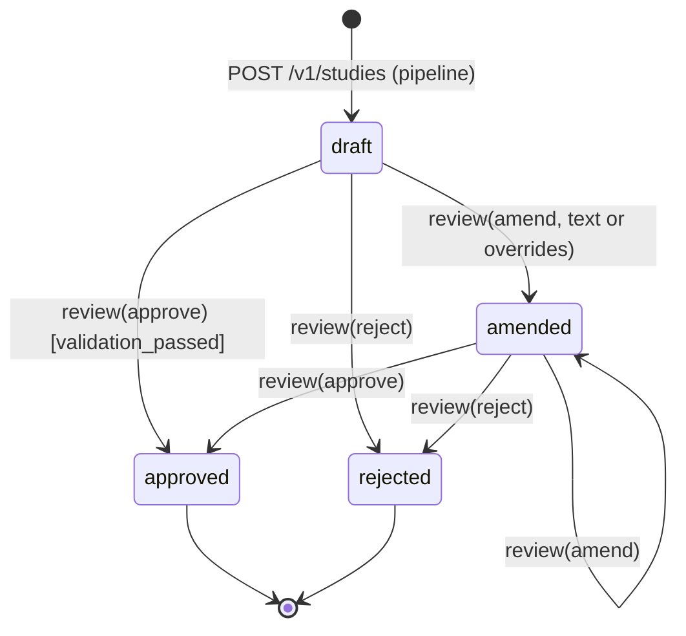

# 11 — API Specification

Status: draft v0.1 — 2026-11-25 · Part of the Radio R&D blueprint (see 00-index.md)

The machine-readable contract is generated from code and must not be hand-edited:

- `docs/blueprint/schemas/openapi.json`: `uv run radio export-openapi`, from `src/radio/api/app.py`
- `docs/blueprint/schemas/analysis-result.schema.json`: `uv run radio export-schema`, from `src/radio/schema/findings.py`

This document explains the contract, its safety semantics, and how the Phase-1 prototype API grows into the clinical service described in 10-system-architecture.md.

## 1. Design principles

1. **Drafts only.** Every AI result is created with `review_status = draft`. Only a review by an authenticated radiologist can move it to `approved`, `amended` or `rejected`. Nothing is ever auto-finalised.
2. **Immutable AI output.** The AI draft (the IR plus `DraftReport`) is never modified. Reviews are appended, and the radiologist's final text is stored next to the draft. Every change is a new version.
3. **Tri-state findings, explicit gaps.** Each concept is `present | absent | uncertain | not_assessed`, and a missing concept never means negative. Abstentions return a result whose findings are all `not_assessed`, with no report.
4. **Everything audited.** Each create, view, review and export appends to a hash-chained audit log (`src/radio/audit/log.py`; production uses the `audit_events` table in 12-database-design.md).
5. **Standards at the edges.** Internal JSON IR in the middle. DICOM SR (TID 1500) and FHIR `DiagnosticReport` at the boundaries. DICOMweb for images.

## 2. Phase-1 prototype endpoints (implemented)

Prototype auth is a stub: `X-User-Id` and `X-User-Role` headers stand in for OIDC bearer tokens with RBAC (§5).

| Method & path | Role | Purpose | Success | Errors |
|---|---|---|---|---|
| `GET /v1/health` | any | Liveness, model version, `research_only` flag, audit-chain validity | 200 | — |
| `POST /v1/studies` | any authenticated | Upload one DICOM (CR/DX) or PNG/JPEG. Optional form fields `indication`, `view_position`. Runs the pipeline synchronously and returns `AnalysisResult` | 201 | 401; 503 if no model loaded; 422 bad form |
| `GET /v1/studies/{id}` | any authenticated | Full `AnalysisResult` (IR, draft, reviews) | 200 | 401, 404 |
| `GET /v1/studies/{id}/report` | any authenticated | Plain-text report. Shows `[DRAFT]` plus the AI disclaimer, or `[APPROVED by …]` plus the radiologist's text | 200 | 401, 404 |
| `POST /v1/reports/{id}/review` | **radiologist** | Body `ReviewRequest {action: approve\|amend\|reject, final_report_text?, finding_overrides[], comment?}` | 200 | 401; 403 if not a radiologist; 404; 409 if already final, if `approve` is used on a draft that failed validation, or if an override references an unknown finding; 422 if `amend` has no content |
| `GET /v1/studies/{id}/sr` | any authenticated | DICOM Comprehensive SR (TID 1500). `CompletionFlag=PARTIAL` and `VerificationFlag=UNVERIFIED` until approved | 200 `application/dicom` | 409 for abstentions or non-DICOM input |
| `GET /v1/studies/{id}/fhir` | any authenticated | FHIR R4B `DiagnosticReport` with contained `Observation`s. `status` is `preliminary`, then `final` / `amended` / `cancelled` | 200 | 404 |

### 2.1 Review state machine



These transitions are enforced in `AnalysisResult.apply_review` and the model validator. A result cannot claim `approved` / `amended` / `rejected` unless a matching review exists. `in_review` is reserved for the worklist "claimed by reader" state (Phase 5).

### 2.2 Example: create

```bash
curl -s -X POST localhost:8000/v1/studies \
  -H 'X-User-Id: tech-01' -H 'X-User-Role: technologist' \
  -F file=@phantom_0.dcm -F indication='Cough, fever'
```

Abridged response:

```json
{
  "schema_version": "0.1.0",
  "result_id": "8f1c…",
  "study": {"modality": "DX", "anatomical_region": "chest", "view_position": "PA", "source_format": "dicom"},
  "image_quality": {"status": "adequate", "issues": [], "ood_score": 21.4, "ood_threshold": 30.9, "out_of_distribution": false},
  "findings": [
    {"code": "pleural_effusion", "status": "uncertain", "provenance": "model_inferred",
     "uncertainty_reasons": ["calibrated_probability_between_thresholds"],
     "evidence": {"calibrated_probability": 0.41, "threshold_absent": 0.12, "threshold_present": 0.63, "…": "…"},
     "localizations": [{"method": "activation_map", "validated": false, "bbox": {"x_min": 610, "…": "…"}}]},
    {"code": "pneumothorax", "status": "absent", "…": "…"},
    {"code": "fracture", "status": "not_assessed", "not_assessed_reason": "not_in_model_label_space"}
  ],
  "critical_status": "none_detected",
  "uncertainty_status": "elevated",
  "report": {"ai_generated": true, "validation_passed": true, "findings": [{"text": "Possible pleural effusion; …", "kind": "uncertain", "finding_ids": ["…"]}], "…": "…"},
  "review_status": "draft",
  "model_versions": {"radio-cxr-classifier": "vit_small_patch14_dinov2.lvd142m@3be1…", "report_generator": "radio.template-v0.1"}
}
```

### 2.3 Example: approve or amend

```bash
curl -s -X POST localhost:8000/v1/reports/8f1c…/review \
  -H 'X-User-Id: rad-07' -H 'X-User-Role: radiologist' -H 'Content-Type: application/json' \
  -d '{"action":"amend","final_report_text":"Small left pleural effusion. No pneumothorax.",
       "finding_overrides":[{"finding_id":"…","status":"present","note":"confirmed, left"}]}'
```

## 3. Production API (Phase 5, planned)

| Area | Endpoint / interface | Notes |
|---|---|---|
| Image ingest from PACS | DICOM C-STORE SCP (pynetdicom) and DICOMweb STOW-RS receiver; or the archive pushes via routing rules | Async. Returns 202 plus a job id. Ingest triggers de-identification in the research tenant only |
| Jobs | `GET /v1/jobs/{id}` | Queue-backed (Redis/RQ or equivalent, per 10-system-architecture.md §2). Status `queued \| running \| succeeded \| abstained \| failed` |
| Worklist | `GET /v1/worklist?status=draft&priority=critical` | Critical-suspected studies sort first. Supports claiming (`in_review`) |
| Finding-level review | `PATCH /v1/results/{id}/findings/{finding_id}` (accept / reject / edit status, laterality, location) | Each edit is a `finding_override` with reason. Feeds QA metrics (08 §4) |
| Report versions | `GET /v1/reports/{id}/versions`, `POST /v1/reports/{id}/versions` | Diffs between AI draft and final text; edit distance stored |
| Critical notifications | `POST /v1/notifications/ack` plus a WebSocket/SSE stream | Escalation timers per 09-safety-validation.md §4 |
| Outbound results | DICOM SR / SEG → PACS (STOW-RS / C-STORE), FHIR `DiagnosticReport` → RIS/EHR, HL7 v2 ORU^R01 where FHIR is unavailable | IHE AI Results (AIR) profile. Conformance tested with Gazelle AIR sample files |
| Model admin | `GET /v1/models`, `POST /v1/models/{version}/promote` | Promotion blocked unless `research_only=false` and validation evidence is attached (05 §7) |
| Monitoring | `GET /v1/metrics/site/{site}` | Override rates, deferral rates, OOD rates, drift (09 §6) |

## 4. Error model

Production adopts RFC 9457 problem details (`application/problem+json`) with a stable `type` URI per error. Specific codes:

| Code | When |
|---|---|
| 409 | State conflicts: already final, approve-after-failed-validation, SR on an abstention |
| 422 | Schema violations |
| 503 | Model unavailable |

Abstention is **not** an HTTP error. It is a valid 201 result carrying `abstention.reason`:
- `unsupported_modality`
- `unsupported_body_part`
- `unsupported_view`
- `non_diagnostic_quality`
- `out_of_distribution`
- `unreadable_dicom`

## 5. Security

- **Authentication:** OIDC (site IdP), short-lived access tokens, mTLS between internal services.
- **Roles:**

| Role | Permissions |
|---|---|
| `technologist` | Submit, view status |
| `radiologist` | View, review, approve |
| `admin` | Model and site config; **cannot approve reports** |
| `auditor` | Read-only audit |
| `service` | Integrations |

- **Approval requires** role `radiologist`, with the user's licence and site credential checked against the site roster. In the prototype this is a header stub only.
- **PHI minimisation:** API payloads carry DICOM UIDs, not names or MRNs. Patient identity resolves only inside the clinical tenant (12-database-design.md §3).
- **Rate limits, request-size limits and DICOM parsing:** run in a sandboxed worker (pydicom on untrusted input).

## 6. Versioning

- URL major version (`/v1`).
- `AnalysisResult.schema_version` (semver). Additive fields are a minor version; changes to meaning are a major version.
- `model_versions` records every component version (classifier `encoder@sha256[:12]`, report generator, pipeline). These are the identifiers a PCCP references.

## Sources

- FastAPI: https://fastapi.tiangolo.com/
- RFC 9457 Problem Details: https://www.rfc-editor.org/rfc/rfc9457
- IHE AI Results (AIR): https://wiki.ihe.net/index.php/AI_Results
- Gazelle AIR test data: https://gazelle.ihe-europe.net/content/airtestdata
- DICOM PS3.16 TID 1500: https://dicom.nema.org/medical/dicom/current/output/chtml/part16/chapter_A.html
- highdicom: https://github.com/ImagingDataCommons/highdicom
- HL7 FHIR R4B DiagnosticReport: https://hl7.org/fhir/R4B/diagnosticreport.html
- pynetdicom: https://github.com/pydicom/pynetdicom
