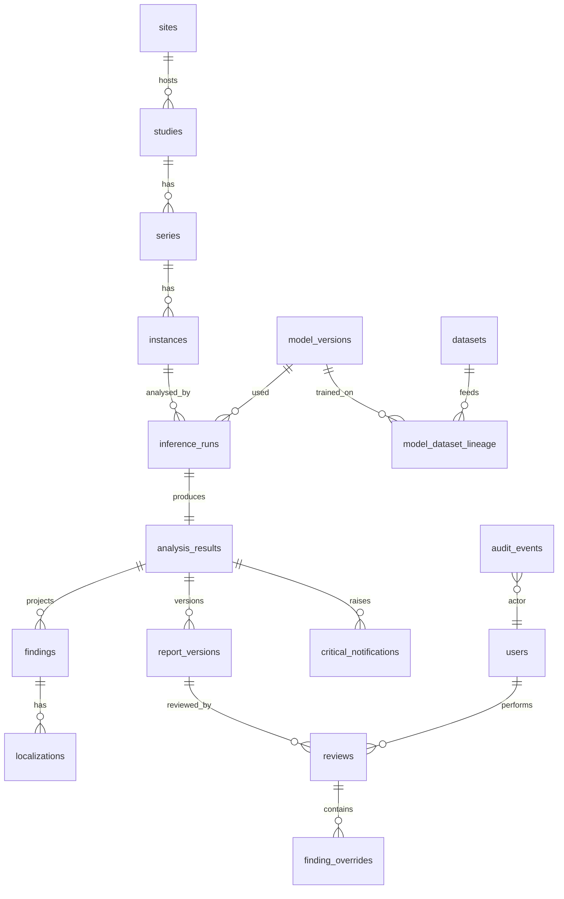

# 12 — Database Design

Status: draft v0.1 — 2026-11-25 · Part of the Radio R&D blueprint (see 00-index.md)

PostgreSQL 16+ is the system of record for the clinical service. Pixel data lives in the DICOM archive or object storage and is referenced by UID or URI, never stored in Postgres.

The Phase-1 prototype uses JSON files plus a JSONL hash chain (`runs/api_store/`) as stand-ins. The tables below mirror the same objects (`src/radio/schema/findings.py`) so the migration is mechanical.

## 1. Principles

- **Two schemas, two trust zones.**
  - `phi` holds patient identity and keyed linkages, is column-encrypted, and is readable only by the integration service.
  - `core` holds everything else, keyed by surrogate IDs and DICOM UIDs.
  - The research environment gets neither. It receives de-identified exports (10-system-architecture.md §4).
- **Append-only clinical history.**
  - `analysis_results`, `report_versions`, `reviews` and `audit_events` are insert-only.
  - Triggers reject `UPDATE`/`DELETE`.
  - Corrections are new rows.
- **IR as JSONB plus normalised projections.**
  - The full validated `AnalysisResult` is stored verbatim (`ir jsonb`) with its `schema_version`.
  - `findings` and `localizations` are projections for querying and monitoring, written in the same transaction.
- **Status enums mirror the schema.** Postgres enums `finding_status`, `provenance`, `review_status` and so on match the Pydantic `StrEnum`s exactly. A CI test compares them.

## 2. Entity overview



## 3. DDL (core tables)

```sql
CREATE SCHEMA core; CREATE SCHEMA phi;

CREATE TYPE core.finding_status AS ENUM ('present','absent','uncertain','not_assessed');
CREATE TYPE core.provenance     AS ENUM ('image_observed','model_inferred','clinical_history',
                                         'prior_report','radiologist_entered','study_metadata');
CREATE TYPE core.review_status  AS ENUM ('draft','in_review','approved','amended','rejected');
CREATE TYPE core.review_action  AS ENUM ('approve','amend','reject');
CREATE TYPE core.quality_status AS ENUM ('adequate','limited','non_diagnostic','not_assessed');
CREATE TYPE core.critical_status AS ENUM ('none_detected','suspected','not_assessed');
CREATE TYPE core.licence_verdict AS ENUM ('OK','CONDITIONAL','RESEARCH-ONLY','UNVERIFIED','UNAVAILABLE');

CREATE TABLE core.sites (
  site_id        uuid PRIMARY KEY,
  name           text NOT NULL,
  country        char(2) NOT NULL,            -- US / EU member / IN: drives regulatory config
  timezone       text NOT NULL,
  config         jsonb NOT NULL DEFAULT '{}'  -- thresholds overrides only via PCCP-governed change
);

CREATE TABLE core.users (
  user_id        uuid PRIMARY KEY,
  site_id        uuid REFERENCES core.sites,
  idp_subject    text UNIQUE NOT NULL,        -- OIDC sub; no names stored here
  role           text NOT NULL CHECK (role IN ('technologist','radiologist','admin','auditor','service')),
  active         boolean NOT NULL DEFAULT true
);

CREATE TABLE phi.patients (                    -- encrypted columns (pgcrypto / app-level envelope keys)
  patient_key    uuid PRIMARY KEY,
  site_id        uuid NOT NULL REFERENCES core.sites,
  mrn_enc        bytea NOT NULL,
  name_enc       bytea,
  birth_date_enc bytea
);

CREATE TABLE core.studies (
  study_id            uuid PRIMARY KEY,
  site_id             uuid NOT NULL REFERENCES core.sites,
  patient_key         uuid NOT NULL,          -- FK to phi.patients enforced in the integration service only
  study_instance_uid  text UNIQUE NOT NULL,
  accession_hash      text,                   -- HMAC(site_key, accession)
  modality            text NOT NULL,
  body_part           text,
  study_datetime      timestamptz,
  indication          text,                   -- provenance = clinical_history
  received_at         timestamptz NOT NULL DEFAULT now()
);

CREATE TABLE core.series (
  series_id           uuid PRIMARY KEY,
  study_id            uuid NOT NULL REFERENCES core.studies,
  series_instance_uid text UNIQUE NOT NULL,
  modality            text NOT NULL,
  view_position       text
);

CREATE TABLE core.instances (
  instance_id         uuid PRIMARY KEY,
  series_id           uuid NOT NULL REFERENCES core.series,
  sop_instance_uid    text UNIQUE NOT NULL,
  sop_class_uid       text NOT NULL,
  storage_uri         text NOT NULL,          -- DICOMweb WADO-RS URL or object-store key
  rows int, columns int,
  sha256              char(64) NOT NULL
);

CREATE TABLE core.model_versions (
  model_version_id    uuid PRIMARY KEY,
  model_id            text NOT NULL,          -- e.g. radio-cxr-classifier
  version             text NOT NULL,          -- encoder@sha256[:12]
  weights_sha256      char(64) NOT NULL,
  research_only       boolean NOT NULL,
  lineage             jsonb NOT NULL,         -- datasets, weights_init, code licences (05 §7)
  calibration         jsonb NOT NULL,         -- thresholds per label, alphas, calibration split
  validation_evidence jsonb,                  -- links to eval reports (08)
  stage               text NOT NULL CHECK (stage IN ('research','staging','product','retired')),
  created_at          timestamptz NOT NULL DEFAULT now(),
  UNIQUE (model_id, version),
  CHECK (stage <> 'product' OR (research_only = false AND validation_evidence IS NOT NULL))
);

CREATE TABLE core.inference_runs (
  run_id              uuid PRIMARY KEY,
  instance_id         uuid NOT NULL REFERENCES core.instances,
  model_version_id    uuid NOT NULL REFERENCES core.model_versions,
  pipeline_version    text NOT NULL,
  started_at          timestamptz NOT NULL,
  finished_at         timestamptz,
  outcome             text NOT NULL CHECK (outcome IN ('succeeded','abstained','failed')),
  abstention_reason   text,
  ood_score           real,
  ood_threshold       real,
  quality_status      core.quality_status NOT NULL
);

CREATE TABLE core.analysis_results (           -- immutable AI output
  result_id           uuid PRIMARY KEY,
  run_id              uuid UNIQUE NOT NULL REFERENCES core.inference_runs,
  study_id            uuid NOT NULL REFERENCES core.studies,
  schema_version      text NOT NULL,
  ir                  jsonb NOT NULL,         -- full AnalysisResult as produced (review_status = draft)
  critical_status     core.critical_status NOT NULL,
  validation_passed   boolean,                -- null when abstained
  created_at          timestamptz NOT NULL DEFAULT now()
);

CREATE TABLE core.findings (                   -- projection of ir.findings
  finding_id          uuid PRIMARY KEY,
  result_id           uuid NOT NULL REFERENCES core.analysis_results,
  concept             text NOT NULL,          -- radio.ontology key; radlex_id via ontology table
  status              core.finding_status NOT NULL,
  provenance          core.provenance NOT NULL,
  laterality          text NOT NULL,
  raw_probability     real,
  calibrated_probability real,
  critical            boolean NOT NULL DEFAULT false,
  not_assessed_reason text,
  UNIQUE (result_id, concept),
  CHECK ((status = 'not_assessed') = (not_assessed_reason IS NOT NULL))
);

CREATE TABLE core.localizations (
  localization_id     uuid PRIMARY KEY,
  finding_id          uuid NOT NULL REFERENCES core.findings,
  method              text NOT NULL,          -- detector | segmentation | activation_map | radiologist
  validated           boolean NOT NULL,
  bbox                box,                    -- 2D, source pixel coords; 3D in Phase 7 via bbox3d jsonb
  heatmap_uri         text,
  seg_ref             jsonb                   -- DICOM SEG SOP/segment numbers
);

CREATE TABLE core.report_versions (            -- AI draft = version 0; radiologist edits = 1..n
  report_version_id   uuid PRIMARY KEY,
  result_id           uuid NOT NULL REFERENCES core.analysis_results,
  version             int NOT NULL,
  author_kind         text NOT NULL CHECK (author_kind IN ('ai','radiologist')),
  author_user_id      uuid REFERENCES core.users,
  body                jsonb NOT NULL,         -- DraftReport (ai) or structured final text
  text_rendered       text NOT NULL,
  edit_distance_from_ai real,                 -- word-level normalised (08 §4)
  created_at          timestamptz NOT NULL DEFAULT now(),
  UNIQUE (result_id, version),
  CHECK ((author_kind = 'ai') = (version = 0)),
  CHECK (author_kind = 'ai' OR author_user_id IS NOT NULL)
);

CREATE TABLE core.reviews (
  review_id           uuid PRIMARY KEY,
  result_id           uuid NOT NULL REFERENCES core.analysis_results,
  report_version_id   uuid REFERENCES core.report_versions,
  reviewer_id         uuid NOT NULL REFERENCES core.users,
  action              core.review_action NOT NULL,
  resulting_status    core.review_status NOT NULL,
  comment             text,
  reviewed_at         timestamptz NOT NULL DEFAULT now()
);

CREATE TABLE core.finding_overrides (
  override_id         uuid PRIMARY KEY,
  review_id           uuid NOT NULL REFERENCES core.reviews,
  finding_id          uuid NOT NULL REFERENCES core.findings,
  new_status          core.finding_status NOT NULL,
  new_laterality      text,
  note                text,
  usable_for_training boolean NOT NULL DEFAULT false,  -- only true under an approved governance policy
  governance_policy_id text
);

CREATE TABLE core.critical_notifications (
  notification_id     uuid PRIMARY KEY,
  result_id           uuid NOT NULL REFERENCES core.analysis_results,
  finding_id          uuid NOT NULL REFERENCES core.findings,
  raised_at           timestamptz NOT NULL DEFAULT now(),
  escalation_level    int NOT NULL DEFAULT 0,
  acknowledged_by     uuid REFERENCES core.users,
  acknowledged_at     timestamptz
);

CREATE TABLE core.datasets (
  dataset_id          text PRIMARY KEY,       -- mirrors radio.data.registry.DATASETS
  name                text NOT NULL,
  verdict             core.licence_verdict NOT NULL,
  source_url          text NOT NULL,
  terms_checked       date NOT NULL,
  attribution         text NOT NULL,
  agreement_ref       text                    -- signed DUA / licence document id
);

CREATE TABLE core.model_dataset_lineage (
  model_version_id    uuid REFERENCES core.model_versions,
  dataset_id          text REFERENCES core.datasets,
  role                text NOT NULL CHECK (role IN ('train','calibrate','test','external_test')),
  PRIMARY KEY (model_version_id, dataset_id, role)
);

CREATE TABLE core.audit_events (               -- hash chain, same algorithm as radio.audit.log
  seq                 bigserial PRIMARY KEY,
  ts                  timestamptz NOT NULL DEFAULT now(),
  event               text NOT NULL,
  actor               text NOT NULL,
  subject             text NOT NULL,
  payload_sha256      char(64) NOT NULL,
  prev_hash           char(64) NOT NULL,
  hash                char(64) NOT NULL UNIQUE
);

-- Immutability guard (applied to analysis_results, report_versions, reviews, finding_overrides, audit_events)
CREATE FUNCTION core.forbid_mutation() RETURNS trigger LANGUAGE plpgsql AS
$$ BEGIN RAISE EXCEPTION '% is append-only', TG_TABLE_NAME; END $$;
CREATE TRIGGER analysis_results_immutable BEFORE UPDATE OR DELETE ON core.analysis_results
  FOR EACH ROW EXECUTE FUNCTION core.forbid_mutation();
-- (repeat for the other append-only tables)
```

The current review status of a result is derived from the latest `reviews` row, or `draft` if there is none. It is exposed as a view (`core.result_status`) and never stored as a mutable column.

## 4. Indexes and monitoring queries

- `findings (concept, status)`, `findings (result_id)`, `inference_runs (model_version_id, started_at)`, and `reviews (result_id, reviewed_at DESC)`.
- Monitoring views feed the post-market dashboard (09 §6):

| View | What it tracks |
|---|---|
| `v_override_rate` | Share of AI `present`/`absent` overturned by `finding_overrides`, per site / model / concept / week |
| `v_deferral_rate` | Share of `uncertain` findings |
| `v_abstention_rate` | Abstentions, by reason |
| `v_ood_drift` | Weekly distribution of `ood_score` per site |
| `v_critical_latency` | Time from `raised_at` to `acknowledged_at` |

## 5. Retention and privacy

| Data | Retention |
|---|---|
| Clinical records (`analysis_results`, `report_versions`, `reviews`, `audit_events`) | Per site medical-records law and contract. Implemented with partitioning by month, not deletion |
| `phi.*` | Site's record-retention period; deletable on contract end |

- **Access requests:**
  - **DPDP (India), GDPR (EU):** subject-access and erasure requests are handled at the `phi` layer. Clinical-record retention obligations can override erasure, and counsel must confirm per market.
  - **HIPAA (US):** the service runs under a BAA.
- **Research exports:** de-identified only, with `patient_key` replaced by a per-export salt-hashed ID. A model-training export happens only when `finding_overrides.usable_for_training = true` under a named governance policy.

## Sources

- PostgreSQL documentation (enums, triggers, `box` type, partitioning): https://www.postgresql.org/docs/current/
- DICOM UIDs and SR references: https://dicom.nema.org/medical/dicom/current/output/chtml/part03/
- Internal schema source of truth: `src/radio/schema/findings.py`; registry: `src/radio/data/registry.py`.
