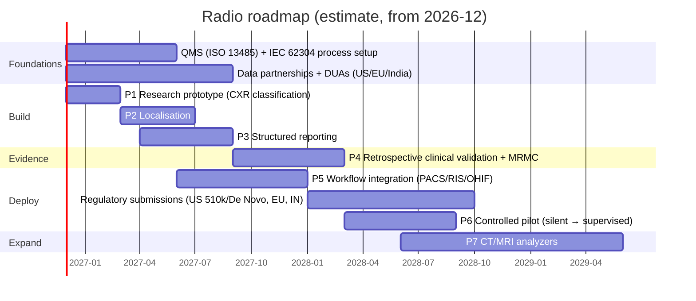

# 15 — Development Roadmap

Status: draft v0.1 — 2026-11-25 · Part of the Radio R&D blueprint (see 00-index.md)

Durations and team sizes are **estimates**, assuming a core team of ~6–10 FTE plus contracted radiologists (see Resources rows). Phases overlap where dependencies allow. Regulatory submission timing depends on evidence and partner data access, which are the critical-path items, not engineering.

## Timeline (estimate)

---

## Phase 1 — Research prototype (CXR classification)

| Field | Detail |
|---|---|
| Objectives | End-to-end pipeline on public data: ingest → QC/OOD → classifier → calibration → IR → template draft → API → audit. Prove the architecture, schema and safety invariants |
| Deliverables | `src/radio` scaffold with tests; findings JSON Schema; NIH CXR14 classifier (Mac smoke run, then a full cloud run); calibration + conformal thresholds; evaluation report with CIs; blueprint docs 00–17; data registry with licence classes |
| Datasets | NIH ChestX-ray14 (commercially usable with attribution). Research-only benchmarks (MIMIC-CXR, CheXpert) only after PhysioNet/Stanford access, and only in the research environment |
| Models | DINOv2 ViT-S/14 (Mac) → ViT-B/14 (cloud); multi-label head; Mahalanobis OOD |
| Engineering tasks | Repo, `uv` env, CI; DICOM ingest + VOI LUT + MONOCHROME1; patient-level splits; masked-BCE training on MPS; temperature + conformal; metrics with patient bootstrap; template generator + validator; FastAPI with review state machine; hash-chained audit; SR/FHIR export (preliminary) |
| Validation criteria | All unit/property tests pass; validator invariants hold on a 10k synthetic IR suite; macro-AUROC reported with CIs on a patient-disjoint test split (feasibility gate, no clinical threshold) |
| Resources (estimate) | 2 ML engineers, 1 backend engineer, 0.2 FTE radiologist advisor; Mac + ≤ $0.5k cloud |
| Dependencies | None external (public data) |
| Risks | NIH label noise makes metrics optimistic or pessimistic → treat as feasibility only; Mac disk space (~41 GB free) → external SSD or a cloud bucket; MPS op gaps → CPU fallback |

## Phase 2 — Localisation

| Field | Detail |
|---|---|
| Objectives | Boxes, masks and anatomy segmentation; heatmaps for display; laterality from geometry; CXR SSL encoder on licensed data |
| Deliverables | Detector (Faster R-CNN baseline → RT-DETR/D-FINE); nnU-Net 2D anatomy (lungs, heart, mediastinum, devices); CTR estimator; localisation in the IR (`bbox2d`, `mask_ref`); SEG/SR with SCOORD export; FROC evaluation |
| Datasets | ChestX-Det (Apache-2.0), SIIM-ACR Pneumothorax (commercial OK, no redistribution), RSNA Pneumonia 2018 (after written RSNA confirmation), partner annotations as they arrive; VinDr-CXR for research benchmarking only |
| Models | DINOv2-CXR encoder (continued SSL), detector heads, nnU-Net 2D |
| Engineering tasks | Annotation pipeline (MONAI Label/CVAT), box fusion, laterality logic, overlay rendering, ONNX export + parity tests |
| Validation criteria | FROC sensitivity ≥ 0.80 @ 1 FP/image for pneumothorax and effusion (proposal); laterality accuracy ≥ 0.98; Dice ≥ 0.95 lungs / ≥ 0.90 heart on held-out data (proposal) |
| Resources (estimate) | +1 CV engineer; radiologist annotation ≈ 1,100·R hours-cost (see 14 §6); $4–8k compute |
| Dependencies | P1 pipeline; annotation contracts; RSNA terms clarification |
| Risks | Small commercially clean box sets → partner annotation on the critical path; shortcut learning on tubes and drains |

## Phase 3 — Structured reporting

| Field | Detail |
|---|---|
| Objectives | Radiologist-authored template library; validator rule set complete; optional constrained LLM rephraser; QA metrics |
| Status (2026-11-25) | Started on public data. Done: versioned template library (engineering draft, awaiting radiologist sign-off), validator perturbation suite, comparison against verified priors, report-level evaluation on ChestX-Det. Blocked on radiologists: gold QA set, template authorship, guideline rules. Main finding: the reporting layer is safe, but the Phase-1 classifier leaves about 5 "possible" findings per draft (13 §6) |
| Deliverables | Template library v1 (all Phase-1/2 findings × status × laterality × provenance); validator with rules a–i; gold QA set (~300); synthetic perturbation suite; optional LoRA rephraser + constrained decoding; report metrics dashboard |
| Datasets | Partner image–report pairs (for rephraser target phrasing and Stage-5 alignment); research-only pairs (MIMIC-CXR, CheXpert Plus) for internal comparison only |
| Models | Templates; small Apache-2.0 LLM (licence re-verified at selection); image–text alignment model (research → product when licensed pairs exist) |
| Engineering tasks | Template DSL + tests; sentence-to-finding linking; comparison/prior handling; KB of guideline-backed recommendations; validator; report editor contract with the UI |
| Validation criteria | IR-faithfulness violations = 0; hallucination ≤ 2% of reports, laterality error ≤ 0.5%, unsupported recommendations = 0 on the gold QA set (proposals); rephraser enabled only if non-inferior to templates on all safety metrics |
| Resources (estimate) | 1 NLP engineer, 2–3 radiologists for templates (80–150 h), gold QA (60 h) |
| Dependencies | P1 IR schema stable; partner reports for the rephraser |
| Risks | Template stiffness lowers acceptance → measured in P4; LLM licence changes → templates-only fallback |

## Phase 4 — Retrospective clinical validation

| Field | Detail |
|---|---|
| Objectives | Regulatory-grade standalone and reader-study evidence on external multi-site data |
| Deliverables | SAPs; locked external test sets (≥ 3 institutions, ≥ 1 per launch market); standalone performance report incl. subgroups; MRMC reader study report; usability (IEC 62366-1) formative and summative reports; clinical evaluation report draft |
| Datasets | Partner retrospective data (US, EU, India) with 3-reader adjudicated reference; MIDRC (commercial agreement) where applicable |
| Models | Frozen candidate (`clinical-candidate` stage) |
| Engineering tasks | Evaluation service in the validation environment; reader-study platform (OHIF-based, blinded, randomised); iMRMC/RJafroc analysis pipelines |
| Validation criteria | Per-claim sensitivity lower CI ≥ target at specificity ≥ target; ECE ≤ 0.05; fairness criterion met; MRMC primary endpoint met (08 §8) |
| Resources (estimate) | 1 clinical scientist, 1 biostatistician, 15 readers (~500 h), annotation (~650 h), CRO optional |
| Dependencies | DUAs; ethics approvals at each site; P2–P3 frozen |
| Risks | Endpoint not met → iterate (time and cost); site data heterogeneity; reader recruitment |

## Phase 5 — Workflow integration

| Field | Detail |
|---|---|
| Objectives | Production-grade integration with PACS/RIS/reporting and the review UI |
| Deliverables | DICOM gateway (C-STORE/STOW), archive integration (dcm4chee or customer PACS), OHIF `radio-review` extension, SR TID 1500/SEG/GSPS output, FHIR DiagnosticReport + HL7 ORU, IHE AIR conformance tests (Gazelle test data), SSO, audit, monitoring, deployment packages (appliance + VPC + SaaS) |
| Datasets | Synthetic and anonymised integration test studies; IHE AIR test SRs |
| Models | Same frozen model, ONNX/Triton served |
| Engineering tasks | See 10-system-architecture.md; 524B security file (threat model, SBOM, pen-test); performance and HA testing |
| Validation criteria | End-to-end latency p95 ≤ 60 s (proposal); zero PHI in logs (automated test); never-auto-finalise integration tests pass against each RIS integration; pen-test with no high or critical findings open |
| Resources (estimate) | 2 backend, 1 frontend (OHIF/React), 1 DevSecOps, 0.5 integration specialist |
| Dependencies | Pilot-site IT engagement; vendor RIS/PACS interfaces |
| Risks | Vendor integration variance; AGPL contamination if Orthanc is extended (blocked by policy) |

## Phase 6 — Controlled pilot

| Field | Detail |
|---|---|
| Objectives | Supervised clinical deployment **only after** the required validation and approvals (regulatory clearance in that market, or an approved investigational/clinical-study framework, plus ethics approval and site governance) |
| Deliverables | Silent-mode report (≥ 8 weeks); supervised pilot report (acceptance, edit rates, time-to-sign, critical-alert PPV, incidents); post-market surveillance plan in operation |
| Datasets | Live site data under contract; no training use of corrections unless governance-approved |
| Models | Cleared/approved version only; PCCP-governed recalibration if permitted |
| Engineering tasks | Monitoring dashboards (Evidently), kill switch, on-call, feedback capture |
| Validation criteria | 08 §8, Phase 6 gate; no serious incident attributable to AI |
| Resources (estimate) | 1 clinical lead per site, ops on-call, radiology champion |
| Dependencies | Phase 4 evidence; regulatory status per market; site contracts (BAA/DPA) |
| Risks | Automation bias in real use; workflow friction; regulatory delays |

## Phase 7 — Expansion (CT, MRI, more CXR findings)

| Field | Detail |
|---|---|
| Objectives | New `Analyzer` plug-ins: e.g. CT head haemorrhage, CT chest nodules/PE, brain MRI tumour segmentation; expanded CXR findings (devices, fractures) |
| Deliverables | Per-analyzer model, ontology subset, templates, validation package, PCCP/submission per indication |
| Datasets | Commercially usable: MSD (CC-BY-SA 4.0), BraTS 2021 on TCIA (CC BY 4.0). Research-only: RSNA ICH, RSNA PE. Partner CT/MRI for product |
| Models | nnU-Net 3D / MONAI; 3D detection; same IR + report stack |
| Engineering tasks | 3D preprocessing (series selection, reformat), volumetric localisation in IR (`bbox3d`, SEG frames), viewer MPR overlays |
| Validation criteria | Per-indication protocols mirroring 08 |
| Resources (estimate) | Per analyzer: 2 ML engineers + radiology subspecialist time; 3D compute ≥ 10× the 2D budget (assumption) |
| Dependencies | Platform stable from P5; cloud GPUs (3D convolutions are not supported on MPS per nnU-Net docs, unverified for current PyTorch) |
| Risks | Licence limits on public CT data; subspecialist annotation cost |

## Sources

- Dataset licence verdicts: 04-dataset-licensing-matrix.md (NIH Box FAQ, Kaggle rules pages, RSNA terms PDFs, TCIA, medicaldecathlon.com; checked 2026-11-25)
- Compute and fee estimates: 14-infrastructure-costs.md
- Validation gates: 08-evaluation-protocol.md · Safety and PCCP: 09-safety-validation.md · Regulatory pathways: 17-commercial-regulatory.md
- IHE AIR test data (Gazelle): https://gazelle.ihe-europe.net/content/airtestdata
- nnU-Net install notes on MPS: https://github.com/MIC-DKFZ/nnUNet
